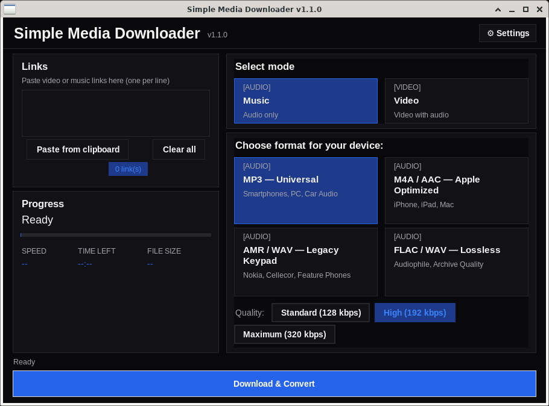
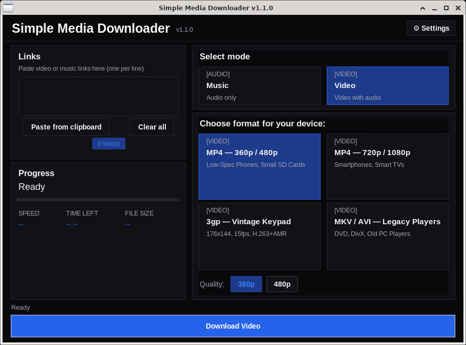
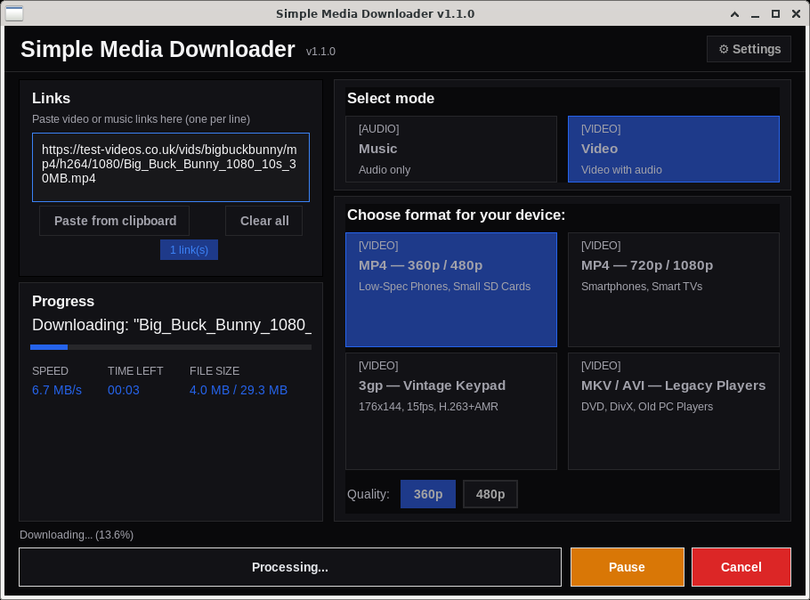
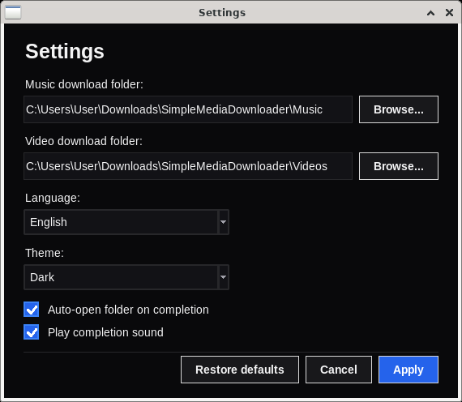

# Simple Media Downloader

-blue)

A simple Windows app to download videos and music from YouTube, Facebook, Instagram, TikTok, X and more. Paste a link, pick a format, pick a quality, done. Made to be easy enough for anyone in the family to use.

## Features

- **Music and Video modes** with ready-made format cards:
  - Music: MP3 (universal), M4A/AAC (Apple devices), AMR/WAV (keypad and feature phones), FLAC/WAV (lossless)
  - Video: MP4 360p/480p, MP4 720p/1080p, 3GP (vintage keypad phones), MKV/AVI (legacy players)
- **Quality picker** for every format (for example 128k / 192k / 320k for MP3)
- **Works with many sites**: YouTube, Facebook, Instagram, TikTok, X/Twitter, and many more (powered by yt-dlp)
- **Everything bundled**: yt-dlp and ffmpeg are included in the download. Nothing else to install
- **Three languages**: English, Bengali, Hindi
- **Light and dark themes**
- **Organized downloads**: separate folders for Music and Videos, with an option to open the folder when a download finishes
- **Update checker built in**: the app tells you when a new release is available
- **Keyboard shortcuts** for common actions
- **Small, flexible window**: resizable from 800x600 up to full screen, so it can sit beside your browser
- **Free**: no ads, no accounts, no tracking

## Screenshots

| Main window | Format and quality |
|---|---|
|  |  |

| Download in progress | Settings |
|---|---|
|  |  |

## Download

1. Open the [Releases page](https://github.com/swagdon1021/simple-media-downloader/releases).
2. Download the win64 zip from the latest release.
3. Extract the zip anywhere you like (for example Desktop).
4. Run `SimpleMediaDownloader.exe`. No installation needed.

**Requirements:** Windows 10 or 11, 64-bit.

> If Windows SmartScreen warns on first run: click **More info**, then **Run anyway**. The app is not code-signed, so Windows shows this for new apps.

## Usage

1. Copy the link of a video or song (for example from YouTube or Facebook).
2. Paste it into the app.
3. Choose **Music** or **Video** mode.
4. Pick a format card, then pick a quality.
5. Press **Download**. The file lands in `Downloads\SimpleMediaDownloader\Music` or `...\Videos` (you can change these folders in Settings).

## FAQ

**Is it free?**
Yes, completely free. No ads, no accounts.

**Which Windows does it support?**
Windows 10 and 11, 64-bit.

**Do I need to install Python, yt-dlp or ffmpeg?**
No. Everything the app needs is bundled in the zip.

**Where do my downloads go?**
By default to `Downloads\SimpleMediaDownloader\Music` and `Downloads\SimpleMediaDownloader\Videos`. You can change both folders in Settings.

**The app says an update is available. What do I do?**
Open the [Releases page](https://github.com/swagdon1021/simple-media-downloader/releases), download the newest win64 zip, and replace your old app folder with the new one.

**Windows SmartScreen blocked the app. Is it a virus?**
No. The app is simply not code-signed (signing certificates cost money). Click **More info**, then **Run anyway**.

**A site stopped working. Why?**
Video sites change their pages often. Check the Releases page for a newer version, which ships an updated yt-dlp.

## License

MIT License. The app bundles [yt-dlp](https://github.com/yt-dlp/yt-dlp) and [ffmpeg](https://ffmpeg.org/), which remain under their own licenses.
